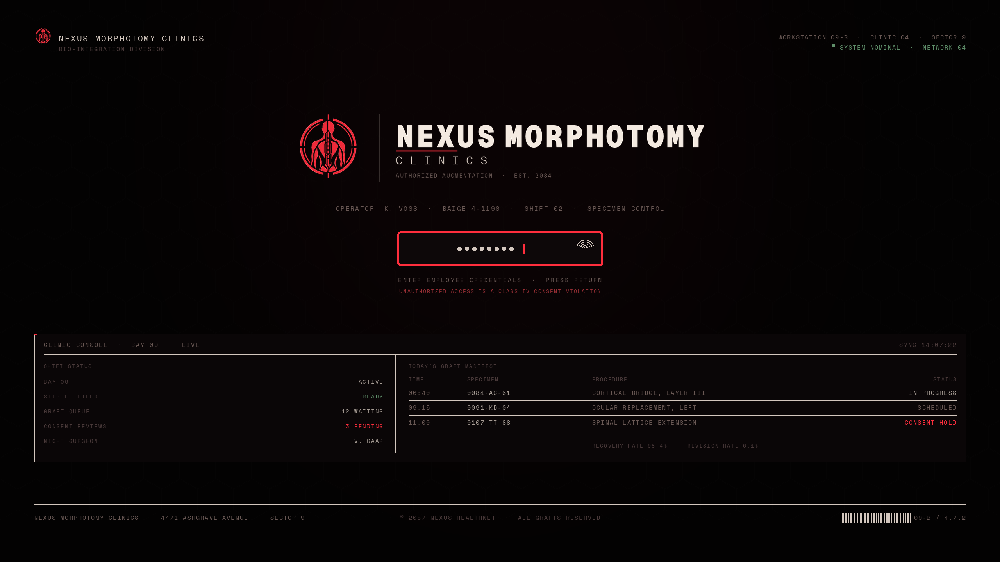

# MORPHOTOMY

A theme for [Omarchy](https://omarchy.org/) about grafts that were not always
consented to.

Alternate timeline: cybernetics are cut into living bodies by morphotomists —
surgeons who are more machine than person. The desktop is the operating bay of
Nexus Morphotomy Clinics, a company that sells augmentation as career
development. Bone and dried blood carry the interface; arterial red is the only
thing that ever lights up, and it means *incision*.


## Install

```bash
omarchy theme install https://github.com/signaldirective/morphotomy
```

That is the whole install: Omarchy clones the repo to
`~/.config/omarchy/themes/morphotomy` and applies it. The theme name comes from
the URL, so it is `morphotomy` for `omarchy theme set` afterwards.

`omarchy theme install` treats a cloned repo as untrusted, and three things
follow from that which are worth knowing before you go looking for them:

- **No Lua ships.** Every `.lua` in a cloned theme is dropped — `hyprland.lua`
  included — and regenerated from `colors.toml`. That is why the arterial
  border gradient lives in `colors.toml` (`hyprland_active_border`) instead of
  being hard-coded in `hyprland.lua`, and why the animations defined in
  `hyprland.lua` only apply to a local install.
- **Window rounding needs its hook.** `hyprland-rounding` holds the corner
  radius, and Omarchy's regenerated `hyprland.lua` knows nothing about it.
  Install the hook once, after the theme is in place:

  ```bash
  omarchy hook install theme-set ~/.config/omarchy/themes/morphotomy/hooks/window-rounding
  ```

- **Login and boot art is a separate step.** `omarchy theme set` does not touch
  Plymouth or SDDM. To publish the clinic lockup to the greeter and the
  boot splash:

  ```bash
  omarchy plymouth set by theme morphotomy     # sudo; logo + colours
  ```

  The seam-and-suture animation is a script-module Plymouth theme, which
  Omarchy has no command for, so it comes from this repo's installer:

  ```bash
  ~/.config/omarchy/themes/morphotomy/install.sh --plymouth --hook
  ```

### Local working copy

`install.sh` is for development, not for users. It copies or symlinks the
checkout into `~/.config/omarchy/themes/morphotomy`:

```bash
./install.sh                    # copy
./install.sh --link --apply     # symlink (edits apply live) and switch to it
./install.sh --plymouth --hook  # custom boot splash, and keep it across theme changes
./install.sh --force            # replace a clone made by `omarchy theme install`
```

A theme the user wrote themselves is unrestricted: with `--link` the theme's own
`hyprland.lua` is staged, so the gradient, curves and rounding come from this
repo directly rather than from `colors.toml` and the hook.

`--plymouth` needs sudo: it installs a script-module theme into
`/usr/share/plymouth/themes/morphotomy`, sets it as the default and rebuilds the
initramfs. `--hook` installs a `theme-set` hook that re-asserts this splash when
something else claims the Plymouth default — `omarchy plymouth reset`, a stock
theme switch on an Omarchy version that republishes its own splash, or a system
update. It is best-effort: a hook cannot prompt for a password, so it only acts
when sudo is passwordless.

## What's in it

| File | Purpose |
|---|---|
| `colors.toml` | the palette every generated template derives from |
| `hyprland.lua` | arterial gradient border, graft shadow, suture/incision curves (local installs only) |
| `hyprland-rounding` | window corner radius, read by the hook below |
| `hooks/window-rounding` | `theme-set` hook: appends that radius to Omarchy's generated `hyprland.lua` |
| `hooks/theme-set-morphotomy.sh` | `theme-set` hook: puts the custom Plymouth splash back after a theme change |
| `btop.theme` | vitals monitor: cauterised orange titles, bone text |
| `chromium.theme`, `icons.theme`, `keyboard.rgb` | browser tint, icon theme, LED colour |
| `backgrounds/1-implantation.webp` | default wallpaper: forced implantation scene |
| `backgrounds/2-surgery-bay.webp` | alternate: surgery bay |
| `backgrounds/3-eye.webp` | alternate: isolated eye, quiet dossier |
| `backgrounds/4-eye-dossier.webp` | alternate: eye with the full overlay |
| `backgrounds/5-hand.webp` | Specimen 311, hand with full dossier |
| `backgrounds/6-heart.webp` | user-supplied Specimen 217, existing HUD preserved |
| `backgrounds/7-brain.webp` | user-supplied Specimen 443, existing HUD preserved |
| `backgrounds/8-surgery.webp` | surgery room, existing in-world HUD preserved |
| `backgrounds/9-eye-diagnostic.mp4` | alternate: fixed eye with 2 animated callouts |
| `backgrounds/9-eye-blink.mp4` | alternate: brief eye blink, repeated every 8 s |
| `backgrounds/9-heart-diagnostic.mp4` | alternate: fixed heart with 3 callouts |
| `backgrounds/9-brain-diagnostic.mp4` | alternate: fixed brain with 3 callouts |
| `source/SURGERY.png` | original branded surgery-room artwork |
| `source/nexus-emblem.png` | supplied Nexus Morphotomy emblem, cyan remapped at build |
| `unlock.png` | clinic lockup: SDDM greeter logo and Plymouth splash centre |
| `preview-unlock.png` | the login screen, as rendered |
| `about.txt` | braille mark for the About screen, 52 columns |
| `screensaver.txt` | braille mark for the idle screensaver, 160 columns |
| `plymouth/morphotomy/` | boot splash: seam closes, fourteen sutures drop in |

Neovim, Alacritty, Kitty, Ghostty, foot, Helix, btop and the rest are generated
by Omarchy from `colors.toml`, so they follow automatically.

## About and screensaver

`about.txt` and `screensaver.txt` are braille renderings of the clinic mark, cut
to the two widths Omarchy expects. Omarchy does not read them from a theme — it
reads `~/.config/omarchy/branding/` — so copy them in once after installing:

```bash
mkdir -p ~/.config/omarchy/branding
cp about.txt screensaver.txt ~/.config/omarchy/branding/
omarchy launch about            # check the About screen
omarchy launch screensaver      # check the idle screen
```

`omarchy branding about text` and `omarchy branding screensaver text` open the
files in an editor; `... reset` puts Omarchy's own mark back.

## Login screen

Logging in is the clinic's workstation, not a generic prompt. `unlock.png` is
the Nexus Morphotomy Clinics lockup; Omarchy publishes it as the SDDM greeter
logo and draws the Plymouth splash around it, so one mark carries you from boot
to unlock.



`preview-unlock.png` is the same screen as designed at 2560×1440: operator line,
credential field, and the bay console running underneath the login. Which parts
are real matters. The greeter's geometry — logo above a 381×67 field on a flat
`#080506` field, and the in-session lock's blurred wallpaper — belongs to
Omarchy, so the preview composes the lockup into that frame rather than
pretending to replace it. What this repo controls is the lockup, the palette and
the splash around them.

The emblem is cut from `source/nexus-emblem.png` by `tools/make-login.py`, which
maps the supplied cyan to arterial red by luminance (so the glow keeps its
shape) and warms the whites toward bone. Everything else — mark placement,
tracking, rules, barcode, telemetry — is drawn geometry, seeded and repeatable.

## Wallpapers

No Blender artwork ships any more. The eight WebP stills remain the default
choices. Four opt-in MP4 alternatives add only diagnostic callouts or the brief
eye blink; they do not zoom, shake, or repaint the source. Background intros
remain disabled.

The default is the forced-implantation still, in `--overlay tag` mode. `5-hand`
uses a Pexels prosthetic-hand photo with the custom Specimen 311 dossier.
`6-heart` and `7-brain` are your pre-branded dossier images; their existing type
is preserved. `8-surgery` is your branded surgery-room image. Original PNGs are
kept in `source/`.

The hand source photo is Pexels #7688766:
https://www.pexels.com/photo/close-up-photo-of-a-prosthetic-arm-7688766/.

## Diagnostic HUD animations

`tools/render-diagnostic-hud.py` draws a separate transparent layer over a still;
the base image stays fixed and unchanged. The eye uses two callouts; heart and
brain use three each. All three videos begin and end on the untouched still.

```bash
python3 tools/render-diagnostic-hud.py tools/diagnostics/eye.json --out /tmp/eye.mp4
python3 tools/render-diagnostic-hud.py tools/diagnostics/heart.json --out /tmp/heart.mp4
python3 tools/render-diagnostic-hud.py tools/diagnostics/brain.json --out /tmp/brain.mp4
bash tools/make-eye-blink-alternate.sh
```

No camera motion, zoom, shake, or audio is used. The blink alternate is based on
`source/eye-blink-seed.mp4`; intros remain disabled.

`source/contact-sheet.png` is the record of the candidates that were considered;
the `source/candidates/` inbox itself has been cleared and is not shipped. To
pull a fresh set and promote one:

```bash
tools/fetch-candidates.py 15                     # refill source/candidates/
tools/compose-dossier.py source/candidates/<file> --out backgrounds/9-<name>.webp \
    --overlay quiet --grade 0.35
./install.sh --link && omarchy theme set morphotomy
```

Candidates are filtered to 16:9-ish, ≥2560×1440, SFW. The project owner has
confirmed redistribution rights for all image assets included in this beta;
retain any per-image attribution or license terms when reusing them.

Drop candidates into `source/` (an inbox, not shipped) and make a still:

```bash
tools/compose-dossier.py source/yours.jpg --out backgrounds/9-yours.webp \
    --title "SPECIMEN 84" --preview /home/ro/.hermes/cache/scratch/check.png
```

`compose-dossier.py` cover-crops to 2560×1440, grades the picture into the
palette, finds a quiet region for the type, and can add the title, metadata,
ruler, barcode and ECG trace. Styles: `--overlay full|quiet|minimal|tag`;
`--anchor left|right|none` overrides placement; `--grade 0..1` controls grading.
`--trace-label` and `--timestamp-label` customize the lower telemetry. Everything
is seeded for repeatable renders.

Background intros are disabled with `omarchy theme bg intro disable`. The
still WebPs remain available beside the four explicit MP4 alternates.

## Palette

```
background   #080506   dried blood black
foreground   #d3c7be   bone
muted        #4a3a3a   dried tissue
accent       #ff2e3d   arterial — links, focus, the active border
selection    #3b0d12   clot
green        #5f8f6a   vitals (kept green on purpose, it has to read instantly)
```

Bone on background measures ~12:1. Red is deliberately not used for body text.

## Regenerating theme elements

The login lockup, Plymouth splash and dossier typography are generated by tools
in `tools/`. Wallpaper imagery is source art, not a Blender render. The theme ships
eight stills plus four opt-in MP4 alternates: diagnostic overlays for eye,
heart and brain, and the approved quick blink. Background intros remain off.

```bash
python3 tools/make-login.py
python3 tools/make-plymouth-assets.py
tools/compose-dossier.py source/your-image.jpg --out backgrounds/9-your-image.webp
```

## Caveats

- `omarchy theme bg next` cycles through eight stills and four explicit
  motion alternates; intros are disabled so selecting one never plays a second
  intro clip.
- No `shell.toml` ships with this theme: Omarchy's generated one already
  derives bar and lock colours from `colors.toml`, and shipping a partial file
  risks losing geometry it sets. A hand-tuned bar is the next lever.
- The Plymouth splash and its hook are the only parts outside `~/.config`, so
  they are the only parts an Omarchy update can disturb.
- Rounding is stated twice: `hyprland.lua` says `rounding = 2`, `hyprland-rounding`
  says `8`. With `hooks/window-rounding` installed the hook wins, so 8 is what a
  cloned install gets; 2 is only what a local `--link` install gets when the hook
  is not installed.
- Cursors are not included: `xcursorgen` (package `xorg-xcursorgen`) is not
  installed here, so the scalpel cursor is still to do.
- The circular emblem in the lockup is derived from supplied artwork that keeps
  its own rights; `source/nexus-emblem.png` is excluded from install and the
  derived `unlock.png` is a redrawn composition, not a copy of the original
  sheet.

## Licence

MIT applies to the theme scripts and original code. Third-party or user-supplied
wallpaper art retains its own source/license; `source/` is excluded from install.
