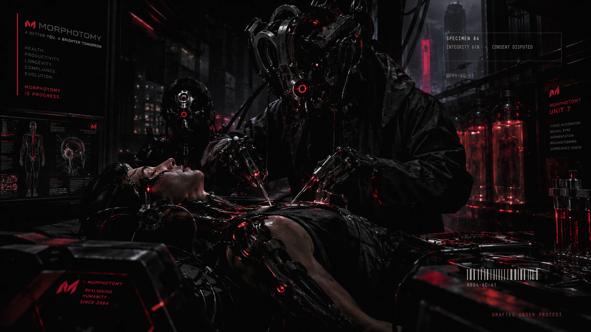

# MORPHOTOMY

A theme for [Omarchy](https://omarchy.org/) about grafts that were not always
consented to.

Alternate timeline: cybernetics are cut into living bodies by morphotomists —
surgeons who are more machine than person. The desktop is the operating bay.
Bone and dried blood carry the interface; arterial red is the only thing that
ever lights up, and it means *incision*.



## Install

```bash
./install.sh                 # copy into ~/.config/omarchy/themes/morphotomy
./install.sh --link --apply  # symlink (edits apply live) and switch to it now
./install.sh --plymouth --hook   # custom boot splash + keep it after theme changes
```

`--plymouth` needs sudo: it installs a script-module theme into
`/usr/share/plymouth/themes/morphotomy`, sets it as the default and rebuilds the
initramfs. `--hook` installs a `theme-set` hook, because Omarchy's theme switch
re-publishes its own Plymouth theme and would otherwise take the splash back.

## What's in it

| File | Purpose |
|---|---|
| `colors.toml` | the palette every generated template derives from |
| `hyprland.lua` | arterial gradient border, graft shadow, suture/incision curves |
| `btop.theme` | vitals monitor: cauterised orange titles, bone text |
| `chromium.theme`, `icons.theme`, `keyboard.rgb` | browser tint, icon theme, LED colour |
| `backgrounds/1-surgery-bay.webp` | primary wallpaper (artwork supplied in `source/`) |
| `backgrounds/1-surgery-bay.mp4` | 24 s animated version, loop-safe |
| `backgrounds/1-surgery-bay-1080.mp4` | battery-friendly variant |
| `backgrounds/intros/1-surgery-bay.mp4` | 6 s boot intro |
| `backgrounds/2-specimen-84.*` | alternate: earlier Blender render + dossier overlay |
| `unlock.png` | wordmark used by Plymouth, SDDM and the lock screen |
| `plymouth/morphotomy/` | boot splash: seam closes, fourteen sutures drop in |

Neovim, Alacritty, Kitty, Ghostty, foot, Helix, btop and the rest are generated
by Omarchy from `colors.toml`, so they follow automatically.

## Wallpapers

The primary wallpaper is artwork supplied in `source/` — a cybernetic surgery
bay — run through the dossier overlay with `--overlay tag`, which adds only a
small specimen plate, a barcode and a hairline frame. Art that already carries
its own typography does not want a second title on top of it.

`2-specimen-84.*` is the earlier Blender render kept as an alternate. It is the
weakest artwork here and is not the default.

The supplied artwork is 1672×940, so it is upscaled to 2560×1440; a 2K or 4K
original would be sharper. Anything ≥2560×1440 dropped into `source/` avoids
that.

Drop candidates into `source/` (an inbox, not shipped) and run:

```bash
tools/compose-dossier.py source/yours.jpg --out backgrounds/1-yours.webp \
    --title "SPECIMEN 84" --preview /tmp/check.png
tools/make-wallpaper-video.sh backgrounds/1-yours.webp   # 1440p, 1080p, 6 s intro
```

`compose-dossier.py` cover-crops to 2560×1440, grades the picture into the
palette, measures local variance to find the quietest part of the frame and
puts the dossier block there, then lays on the title rule, metadata rows,
ruler, barcode and ECG trace. Styles: `--overlay full|quiet|minimal`;
`--anchor left|right|none` overrides the automatic placement; `--grade 0..1`
controls how hard the picture is pushed down. Everything is seeded, so a rerun
is byte-identical.

Video backgrounds are played by `owe-render` (mpv) on this Omarchy build. If the
desktop goes black after switching, the mp4 is probably truncated — check with
`ffprobe` and re-run the encoder.

## Palette

```
background   #080506   dried blood black
foreground   #d3c7be   bone
muted        #4a3a3a   dried tissue
accent       #ff2e3d   arterial — links, focus, the active border
selection    #3b0d12   clot
green        #5f8f6a   vitals (kept green on purpose, it has to read instantly)
```

Bone on background measures ~12:1. Red is deliberately not used for body text.

## Regenerating the art

Everything visual is generated from code in `tools/`:

```bash
python3 tools/make-wordmark.py                       # unlock.png
env -i PATH=/usr/bin:/bin /usr/bin/blender -b \
  -P tools/render-specimen.py -- backgrounds/.render-specimen84.png 2560 48
python3 tools/compose-specimen.py backgrounds/.render-specimen84.png \
  backgrounds/1-specimen-84.webp
python3 tools/make-plymouth-assets.py                # splash assets
tools/make-wallpaper-video.sh                        # mp4 + 1080p + boot intro
```

Blender is invoked with a scrubbed environment on purpose: on this machine a
plain `blender -b` picks the wrong Python out of `PATH` and dies on `import
math`.

## Caveats

- The animated wallpaper is decoded continuously by Quickshell. The 1080p
  variant exists for laptops; `omarchy theme bg next` switches to the still.
- No `shell.toml` ships with this theme: Omarchy's generated one already
  derives bar and lock colours from `colors.toml`, and shipping a partial file
  risks losing geometry it sets. A hand-tuned bar is the next lever.
- The Plymouth splash and its hook are the only parts outside `~/.config`, so
  they are the only parts an Omarchy update can disturb.
- Cursors are not included: `xcursorgen` (package `xorg-xcursorgen`) is not
  installed here, so the scalpel cursor is still to do.

## Licence

MIT. The specimen render and wordmark are generated by the scripts in `tools/`;
no stock imagery is used.
